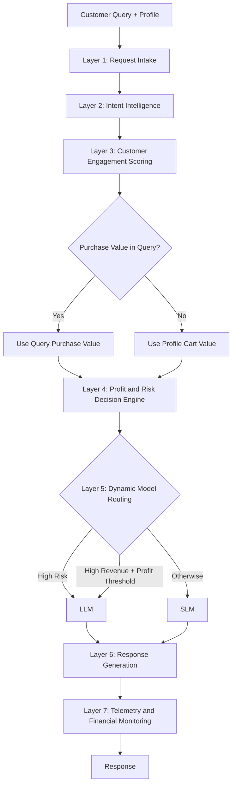

```markdown
# ecommerce-router — Profit & Risk-Aware E-Commerce AI Gateway

Benchmarks **six NLP intent classifiers**, picks a production model, and uses it to decide for every customer query whether a cheap **SLM** or an expensive **LLM** should answer, based on intent risk, customer engagement, purchase probability, purchase value and expected profit.

```text
Traditional chatbot :  Query -> LLM

This project        :  Query -> Intent -> Engagement -> Purchase probability
                       -> Risk + Purchase Value -> Expected Profit
                       -> SLM / LLM routing -> Response -> Financial telemetry
```

> All costs are **simulated demonstration values** (`SLM_COST=0.001`, `LLM_COST=0.020`), not provider prices.
> "Savings" are **Estimated/Theoretical Cost Savings** versus sending 100% of traffic to the LLM.
> Every benchmark number is measured by the script on your machine — nothing is hard-coded.

## 1. Setup (Windows PowerShell)

Python 3.10–3.12 is recommended.

```powershell
cd ecommerce-router
python -m venv venv
.\venv\Scripts\Activate.ps1
pip install -r requirements.txt
```

No NVIDIA GPU? That is fine. To keep the download small you can install the CPU build of PyTorch first:

```powershell
pip install torch --index-url https://download.pytorch.org/whl/cpu
```

Then run the `pip install -r` line.

## 2. Train + benchmark the six models

```powershell
python benchmark_6_models.py --quick
python benchmark_6_models.py --full
```

The benchmark compares six representative NLP approaches:

- Logistic Regression
- Linear SVM
- DistilBERT
- BERT Tiny
- MobileBERT
- RoBERTa Base

The benchmark evaluates accuracy, weighted F1, latency, model size, training time and parameter count.

The first run downloads the dataset and models from Hugging Face. Downloaded files are cached for later runs.

The production model is exported to:

```text
fine_tuned_intent_model/
```

### Reading the benchmark

The selection score is:

```text
score = 0.40*norm(F1)
      + 0.30*norm(Accuracy)
      + 0.20*norm_inverse(Latency)
      + 0.10*norm_inverse(Size)
```

Each term is min-max normalised across the models in that benchmark run.

The **overall winner** is the model with the highest selection score.

For production deployment, the selection is restricted to transformer models. The configured preferred production model is DistilBERT if its score is within the configured tolerance of the best transformer; otherwise, the best transformer is selected.

## 3. Run the application

```powershell
python -m uvicorn main:app --reload
streamlit run app.py
```

API:

```text
http://127.0.0.1:8000
```

Dashboard:

```text
http://localhost:8501
```

Training never starts automatically.

If `fine_tuned_intent_model/` is unavailable, the API can fall back to a keyword-based classifier instead of crashing.

### API example

```powershell
curl.exe -X POST http://127.0.0.1:8000/api/v1/chat -H "Content-Type: application/json" -d "{\"query\":\"I want a laptop for gaming\",\"profile\":{\"cart_value\":1200,\"tier\":\"GOLD\",\"page_views_last_10m\":8}}"
```

Other endpoints:

```text
GET /health
GET /api/v1/telemetry/summary
GET /api/v1/telemetry/recent
```

## 4. Tests and sample data

```powershell
pytest
python generate_sample_data.py --run
```

The test suite verifies API validation, benchmark selection, intent classification, routing and scoring behavior.

## 5. Architecture



Layers 3 and 4 run in this order because expected profit needs the purchase probability.

### Expected Profit

```text
Expected Profit =
    (purchase_probability x effective_purchase_value x 0.95)
    - model_cost
    - (risk_score x 15.0)
```

The system uses the **LLM cost** when calculating expected profit because the decision is asking whether escalating the query to the more expensive model is financially justified.

### Effective Purchase Value

The effective purchase value is determined as follows:

```text
If the customer query contains an explicit purchase value:
    effective_purchase_value = value extracted from query

Otherwise:
    effective_purchase_value = profile.cart_value
```

For example:

```text
"I want to buy a laptop for 20000"
        ↓
Purchase value = 20000
```

while:

```text
"Where is my order?"
        ↓
No purchase value detected
        ↓
Use profile.cart_value
```

### Dynamic Routing

The router follows three main rules:

```text
1. HIGH-RISK intent
       ↓
     LLM

2. HIGH-revenue intent
   + expected profit >= PROFIT_THRESHOLD
       ↓
     LLM

3. Otherwise
       ↓
     SLM
```

Default thresholds:

```text
PROFIT_THRESHOLD = 5.0
HIGH_RISK_THRESHOLD = 0.7
```

This prevents high expected profit alone from forcing every low-risk request to the expensive LLM.

## 6. Customer Engagement and Intent Risk

Purchase probability is estimated from:

- Current cart value
- Recent page views
- Customer loyalty tier

Customers are segmented into:

```text
HOT    >= 0.80
WARM   >= 0.40
COLD   <  0.40
```

The project's canonical intent classes are:

```text
payment_issue
returns_refunds
product_recommendation
order_status
general_inquiry
```

Dataset intent labels are mapped into these canonical classes using keyword rules in `scoring_engine.py`.

Unknown intents use the default risk configuration.

## 7. Reproducibility and Leakage Prevention

- Random seed 42 is used for Python, NumPy, PyTorch and scikit-learn.
- A stratified 80/20 split is used for benchmarking.
- Duplicate query texts are removed before splitting.
- Test labels are used only for evaluation.
- TF-IDF is fitted only on training data.

## 8. LLM Providers

`LLM_PROVIDER=mock` is the default and works offline.

The project can also be configured for:

```text
ollama
openai
groq
```

using the corresponding environment variables.

Provider errors fall back to the mock response.

The SLM path uses template responses selected by the intent model.

## 9. Verified Demo Scenarios

### Scenario 1 — Low-risk operational query

```text
Query:
"Where is my order?"
```

Result:

```text
Canonical intent : order_status
Risk             : 0.15
Revenue          : LOW
Selected model   : SLM
```

### Scenario 2 — High-value purchase query

```text
Query:
"I want to buy a laptop for 20000"
```

Result:

```text
Canonical intent     : product_recommendation
Purchase value       : 20000
Purchase probability : 0.6575
Revenue              : HIGH
Expected profit      : 12490.98
Selected model       : LLM
```

### Scenario 3 — High-risk payment query

```text
Query:
"I was charged twice for the same order"
```

Result:

```text
Canonical intent : payment_issue
Risk             : 0.85
Revenue          : HIGH
Selected model   : LLM
```

## 10. Test Status

The complete automated test suite currently passes:

```text
49 passed, 1 warning
```

The warning is a dependency deprecation warning from the test environment and does not cause test failure.

## 11. Core Contribution

The project extends conventional e-commerce intent classification into a **profit- and risk-aware dynamic AI gateway**.

Instead of sending every customer query to an expensive LLM, the gateway combines:

```text
Customer Query
      +
Customer Profile
      ↓
Intent Understanding
      ↓
Engagement / Purchase Probability
      ↓
Risk Assessment
      +
Query-specific Purchase Value
      ↓
Expected Profit
      ↓
Dynamic SLM / LLM Routing
      ↓
Response + Financial Telemetry
```

The goal is to use the **cheaper SLM whenever it is sufficient**, while escalating valuable or high-risk interactions to the more capable LLM.

## 12. Project Layout

```text
config.py
schemas.py
dataset_utils.py
benchmark_6_models.py
intent_classifier.py
scoring_engine.py
router.py
llm_service.py
telemetry.py
pipeline.py
main.py
app.py
generate_sample_data.py
tests/
results/
models/
fine_tuned_intent_model/
```
```